# 🛍️ ShopEasy – Modern E-Commerce Platform

ShopEasy is a responsive, feature-rich e-commerce storefront and store management application built using **Next.js, React, and Tailwind CSS**. It provides customers with a seamless online shopping experience and administrators with a dedicated dashboard to manage products, customers, inventory, and orders.

The application includes product discovery, shopping cart management, wishlist functionality, customer accounts, simulated checkout, and administrative management features.

---

## 📌 Project Overview

- **Project Name:** ShopEasy
- **Project Type:** Full-Stack Style E-Commerce Frontend Demo
- **Frontend Framework:** Next.js 16
- **UI Library:** React 19
- **Styling:** Tailwind CSS 4
- **Product API:** DummyJSON Products API
- **Deployment:** Not yet deployed

## 🔗 Project Links

- **GitHub Repository:** [ShopEasy – E-Commerce Project](https://github.com/chaitu-pixel/ShopEasy_E-commerce)
- **Live Demo:** Coming Soon

---

## ✨ Key Features

### 🏠 1. Customer Storefront

- Modern and responsive homepage.
- Three-slide hero carousel.
- Product categories and promotional banners.
- Featured and trending products.
- Recently viewed products.
- Mobile-friendly navigation menu.

### 🛒 2. Product Management & Discovery

- Browse products from multiple categories.
- Search products by name.
- Filter products by category, price, and rating.
- Sort products based on price and ratings.
- Pagination for product listings.
- Detailed product information.
- Product stock and price details.
- Add products to cart and wishlist.

### 🔥 3. Deals & Offers

- Dedicated deals page.
- Discounted product listings.
- Search and category filters.
- Minimum discount filtering.
- Sorting options for deals.

### ❤️ 4. Shopping Cart & Wishlist

- Customer-specific shopping cart.
- Add and remove products.
- Increase or decrease product quantities.
- Automatically calculate subtotal.
- Delivery fee calculation.
- Free delivery for orders above ₹999.
- Wishlist management.
- Cart and wishlist data persistence using localStorage.

### 💳 5. Checkout & Payment

- Shipping information form.
- Multiple payment method selections.
- UPI payment option interface.
- Order summary and total calculation.
- Form validation.
- Simulated order placement.
- Local order history.

**Note:** Payments are simulated for demonstration purposes. No real transactions are processed.

### 👤 6. Customer Account Management

- Customer registration.
- Customer login and logout.
- Customer profile management.
- Edit personal information.
- View previous orders.
- Customer-specific shopping data.

### 🔐 7. Authentication System

- Customer login page.
- Separate administrator login page.
- Registration form with password validation.
- Show/hide password functionality.
- Role-based demo navigation.

### 🛠️ 8. Admin Dashboard

A dedicated administration panel provides store management functionality.

**Dashboard Overview**
- Total sales summary.
- Total orders.
- Customer statistics.
- Product inventory summary.
- Low-stock indicators.
- Recent orders.

**Product Management**
- Add new products.
- Edit existing products.
- Delete products.
- Update product stock.
- Search and filter products.
- Sort product listings.

**Order Management**
- View all customer orders.
- Search orders.
- Filter orders by status.
- Update order statuses.
- Delete orders.

**Customer Management**
- View customer directory.
- Search customer records.
- Manage customer information.

**Admin Profile & Settings**
- Administrator profile management.
- Store settings interface.

---

## 🧰 Technologies Used

| Technology | Purpose |
|---|---|
| Next.js 16 | React framework and App Router |
| React 19 | Component-based UI development |
| JavaScript | Application logic |
| Tailwind CSS 4 | Responsive styling |
| Lucide React | Icons |
| React Hot Toast | Toast notifications |
| Axios | Listed HTTP client dependency |
| Fetch API | Product API requests |
| DummyJSON API | External sample product data |
| LocalStorage | Browser-side data persistence |

---

## 🌐 Application Routes

### Customer Routes

| Route | Description |
|---|---|
| `/` | Homepage |
| `/products` | Product catalog |
| `/products/[id]` | Product details |
| `/deals` | Discounted products |
| `/cart` | Shopping cart |
| `/checkout` | Checkout and payment |
| `/wishlist` | Customer wishlist |
| `/profile` | Customer profile and order history |
| `/login` | Login selection page |
| `/login/customer` | Customer login |
| `/login/admin` | Administrator login |
| `/register` | Customer registration |

### Admin Routes

| Route | Description |
|---|---|
| `/admin` | Redirects to admin dashboard |
| `/admin/dashboard` | Admin dashboard overview |
| `/admin/products` | Product management |
| `/admin/products/add` | Add new product |
| `/admin/products/edit/[id]` | Edit product |
| `/admin/orders` | Order management |
| `/admin/customers` | Customer management |
| `/admin/dashboard/profile` | Admin profile and store settings |

---

## 📂 Project Structure

```text
ShopEasy/
│
├── public/
│   ├── images/
│   │   ├── logo
│   │   └── hero images
│   │
│   └── upi/
│       └── payment logos
│
├── src/
│   │
│   ├── app/
│   │   ├── admin/
│   │   │   ├── dashboard/
│   │   │   ├── products/
│   │   │   ├── orders/
│   │   │   └── customers/
│   │   │
│   │   ├── cart/
│   │   ├── checkout/
│   │   ├── deals/
│   │   ├── login/
│   │   ├── products/
│   │   ├── profile/
│   │   ├── register/
│   │   ├── wishlist/
│   │   ├── layout.js
│   │   ├── page.js
│   │   └── globals.css
│   │
│   ├── components/
│   │   ├── admin/
│   │   ├── cart/
│   │   ├── common/
│   │   ├── forms/
│   │   ├── home/
│   │   ├── layout/
│   │   └── products/
│   │
│   ├── constants/
│   ├── context/
│   ├── hooks/
│   ├── services/
│   └── utils/
│
├── AGENTS.md
├── eslint.config.mjs
├── jsconfig.json
├── next.config.mjs
├── package.json
├── package-lock.json
├── postcss.config.mjs
└── README.md
```

---

## ⚙️ Installation & Setup

### Prerequisites

Make sure you have installed:

- Node.js 20.9.0 or later
- npm
- Visual Studio Code
- Git

### Step 1: Clone the Repository

```bash
git clone https://github.com/chaitu-pixel/ShopEasy_E-commerce.git
```

### Step 2: Open the Project

```bash
cd ShopEasy_E-commerce
```

Open the project in VS Code:

```bash
code .
```

### Step 3: Install Dependencies

```bash
npm install
```

### Step 4: Configure Environment Variables (Optional)

Create a `.env.local` file in the project root:

```env
NEXT_PUBLIC_API_URL=https://dummyjson.com
```

### Step 5: Start the Development Server

```bash
npm run dev
```

### Step 6: Open in Browser

Visit:

```text
http://localhost:3000
```

Your ShopEasy application is now running locally!

---

## 📜 Available Scripts

| Command | Description |
|---|---|
| `npm run dev` | Start development server |
| `npm run build` | Build application for production |
| `npm run start` | Start production server |
| `npm run lint` | Run ESLint checks |

---

## 🔌 API Integration

ShopEasy uses the **DummyJSON Products API** to retrieve sample product information.

API Documentation:

https://dummyjson.com/docs/products

Main API operations include:

- Fetch all products.
- Retrieve individual product details.
- Display product categories.
- Load product information for the storefront.

Product prices retrieved from the API are converted from USD to approximate INR for display.

Additional curated sample products are included to improve category coverage.

---

## 💾 Data Storage

The application currently uses browser `localStorage` for demo data persistence.

The following information is stored locally:

- Customer accounts.
- Current signed-in user.
- Shopping cart.
- Wishlist.
- Product catalog changes.
- Customer orders.
- Administrator settings.

**Important:** Data is stored in the current browser and device only. It is not synchronized between users or devices.

---

## 🔑 Demo Admin Credentials

Use the following credentials to access the administrator dashboard locally:

| Field | Credentials |
|---|---|
| Email | admin@shopeasy.com |
| Password | Admin@123 |

**Important Security Notice:** These are demonstration credentials. Authentication is implemented on the client side and is not suitable for production use.

---

## 📸 Application Screenshots

The following screenshots demonstrate the ShopEasy storefront, customer shopping experience, authentication pages, and administration dashboard.

### 1. Storefront & Product Discovery

**Homepage – Desktop View**

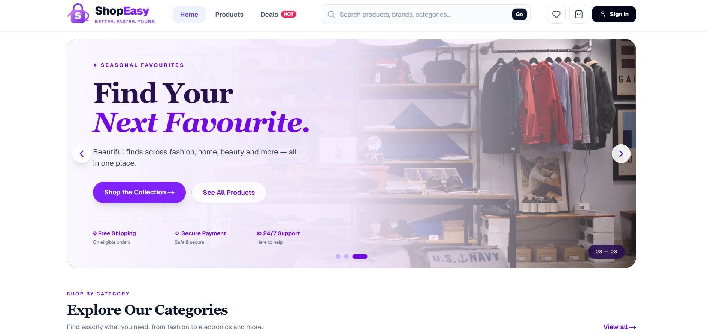

**Product Catalog & Filters**

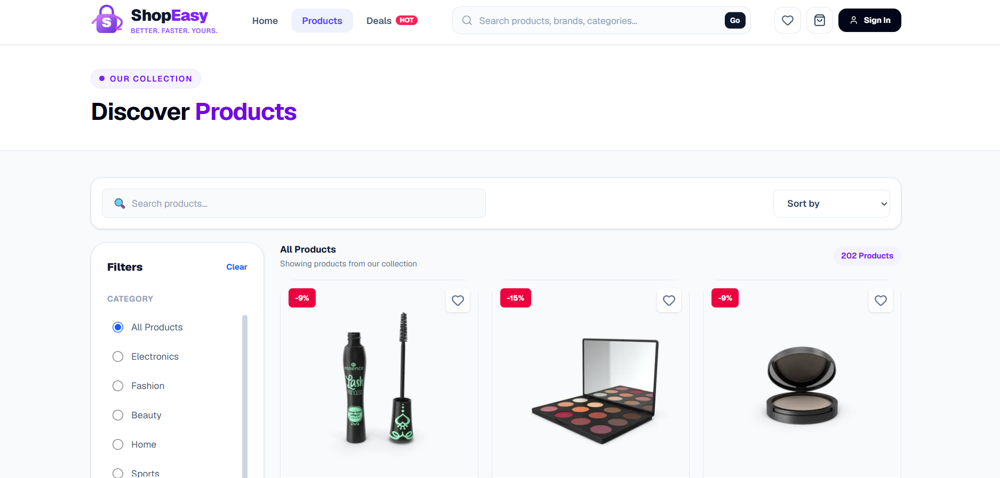

**Product Details**

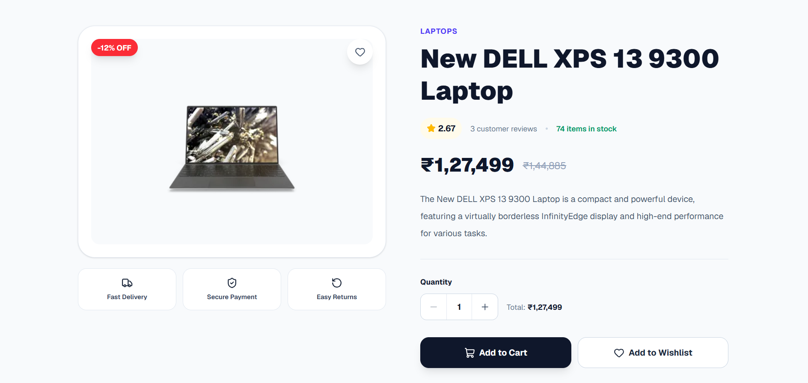

**Top Deals**

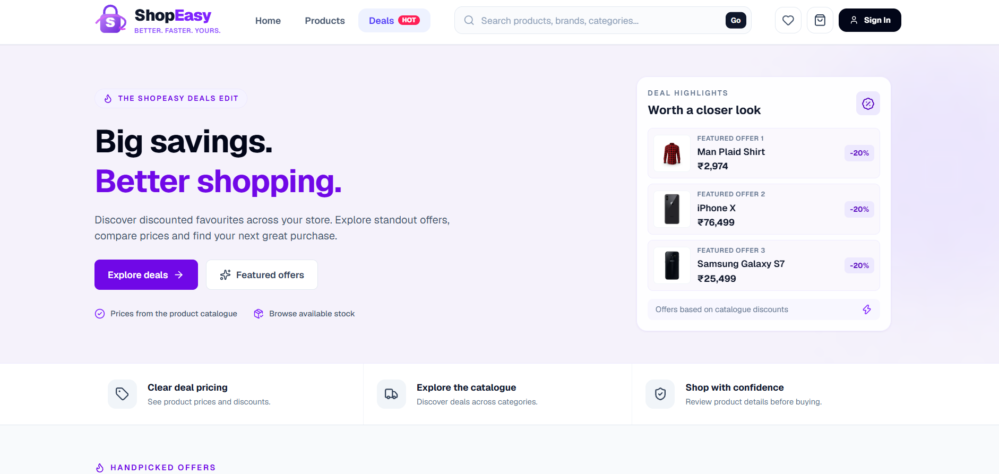


### 2. Customer Shopping Experience

**Shopping Cart**

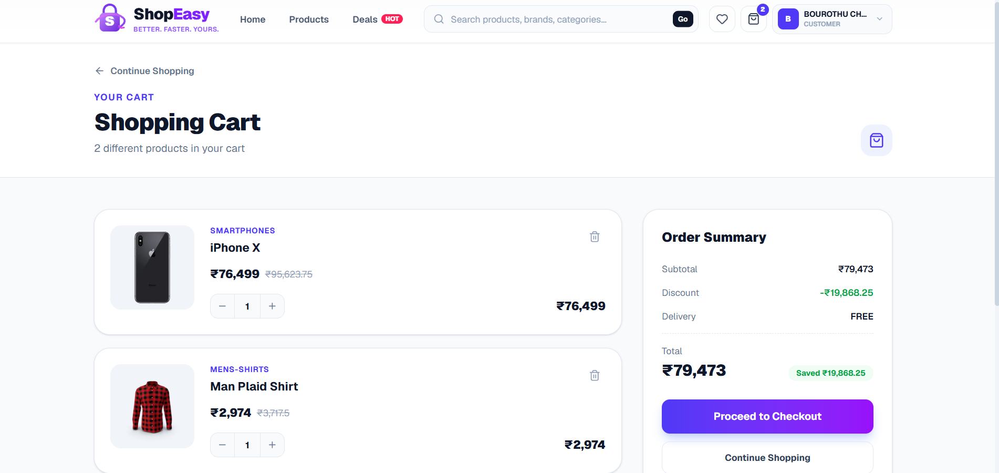

**Checkout & Payment Methods**

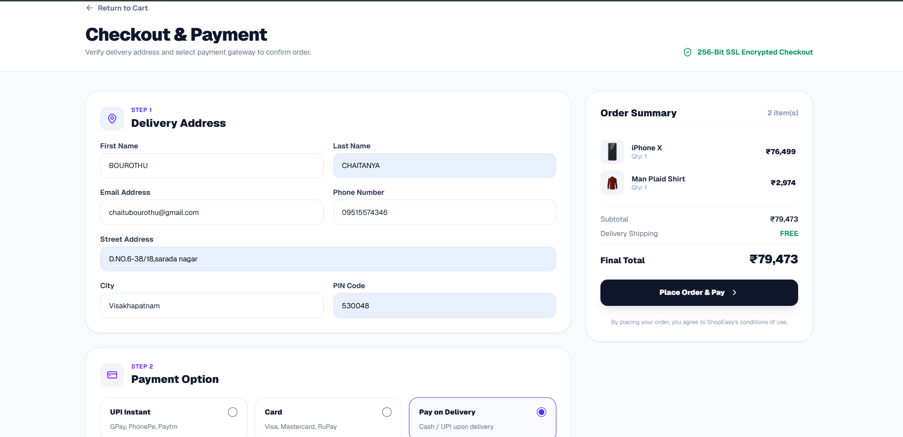

**Wishlist**

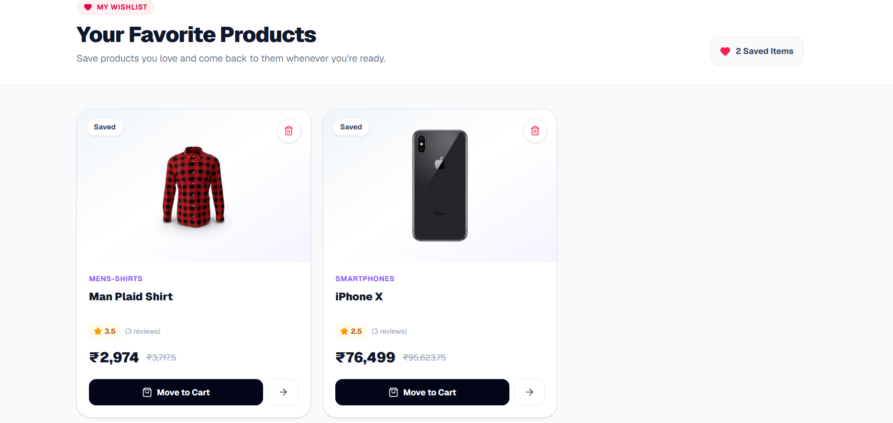

### 3. Authentication & Registration

**Customer Login**

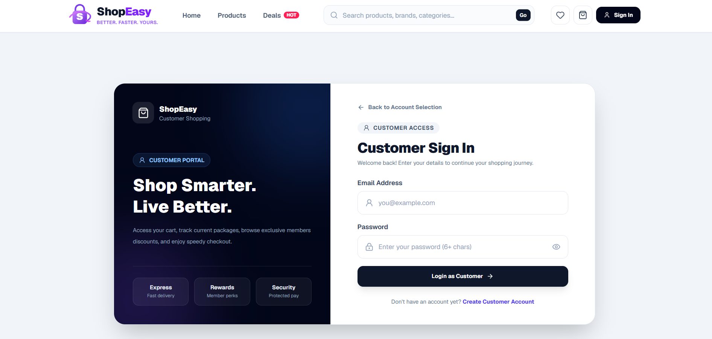

**Customer Registration**

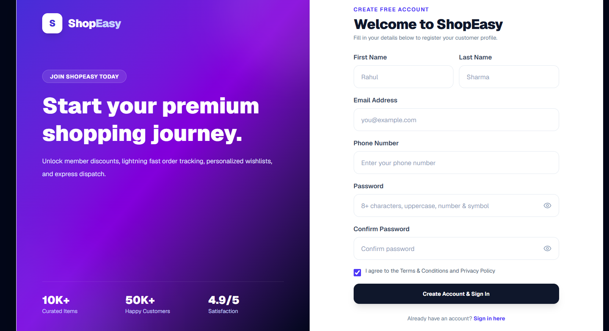

**Admin Login**

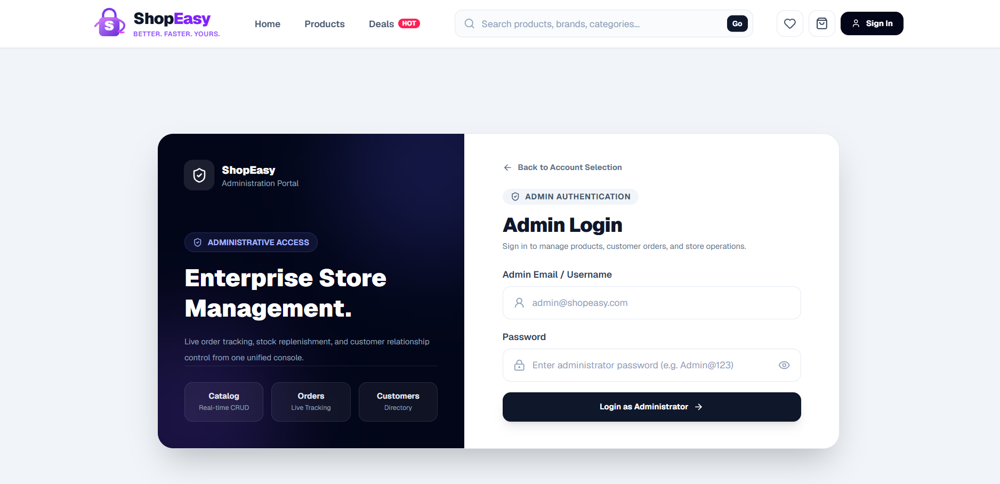

### 4. Admin Portal

**Admin Dashboard & Analytics**

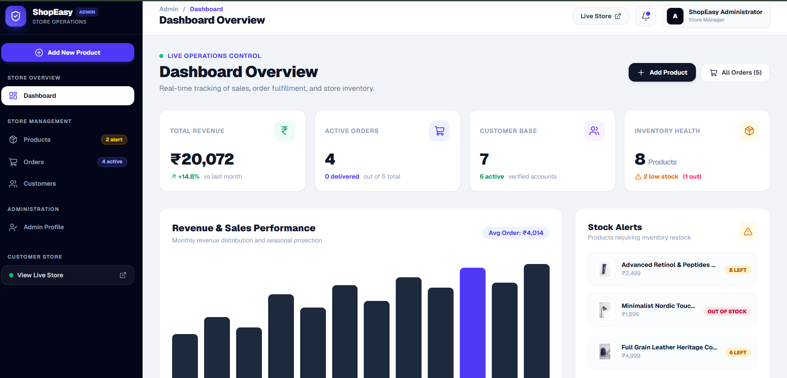

**Product Management**

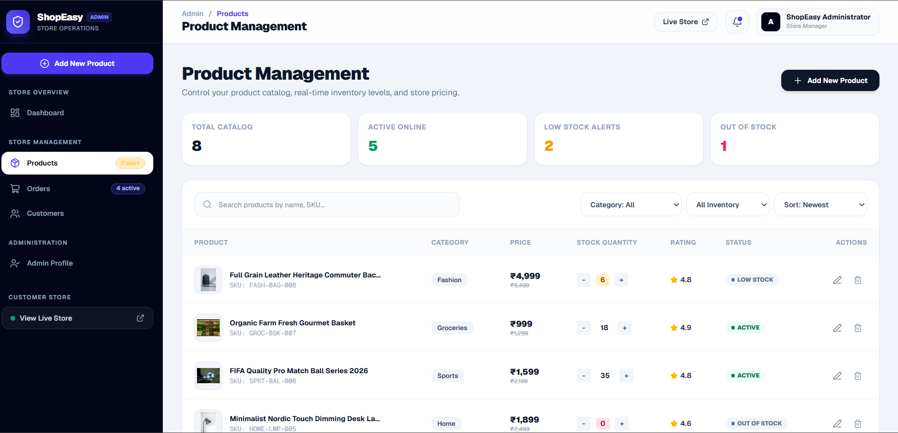

### 5. Responsive Design

**Tablet View – iPad Pro**

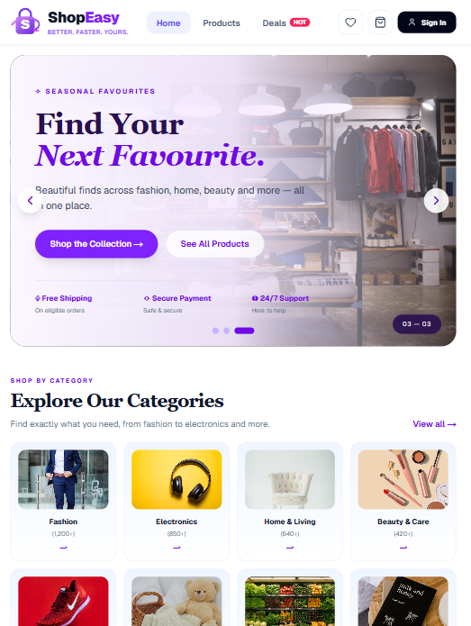

**Mobile View – iPhone 16 Pro Max**

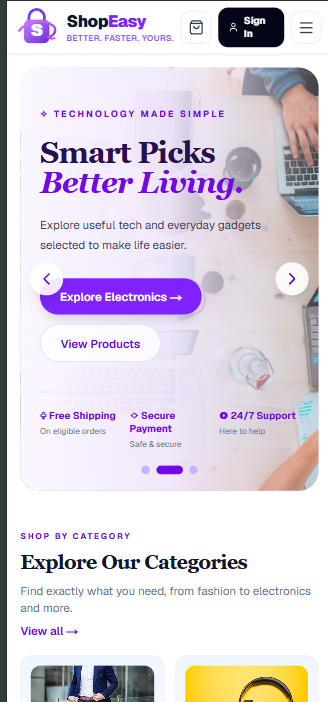

---

## ⚠️ Current Limitations

- No dedicated backend or database is currently integrated.
- Customer accounts and passwords are stored in browser localStorage.
- Administrator credentials are hard-coded in client-side code.
- Authentication is intended for demonstration, not production security.
- Checkout creates simulated orders without processing actual payments.
- UPI and card payment selections do not initiate real transactions.
- Product browsing depends on the external DummyJSON API.
- Some informational footer links and the newsletter form are not fully implemented.
- Browser-local data is not shared across devices or users.

---

## 🚀 Future Enhancements

Planned improvements for ShopEasy include:

- Backend integration using Node.js and Express.js.
- Database integration using MongoDB or MySQL.
- Secure authentication using JWT and password hashing.
- Server-side role-based access control.
- Real payment gateway integration.
- Order tracking and delivery management.
- Product reviews and ratings.
- Email notifications.
- Advanced sales analytics.
- Cloud deployment.

---

## 🎯 Learning Outcomes

Through developing ShopEasy, I gained practical experience in:

- Building responsive web applications using Next.js and React.
- Developing reusable React components.
- Implementing dynamic routing using Next.js App Router.
- Managing application state using React Context and hooks.
- Integrating external APIs using Fetch.
- Implementing shopping cart and wishlist functionality.
- Working with browser localStorage.
- Building customer and administrator interfaces.
- Implementing product and order management operations.
- Designing responsive layouts using Tailwind CSS.
- Debugging and improving frontend application functionality.

---

## 👨‍💻 Developer

**Chaitanya Bourothu**

B.Tech Graduate | Data Science

- **GitHub:** [chaitu-pixel](https://github.com/chaitu-pixel)
- **Project Repository:** [ShopEasy E-Commerce](https://github.com/chaitu-pixel/ShopEasy_E-commerce)

---

⭐ If you find this project interesting, feel free to explore the repository and share your feedback!

**ShopEasy – Making Online Shopping Simple, Smart & Convenient.**